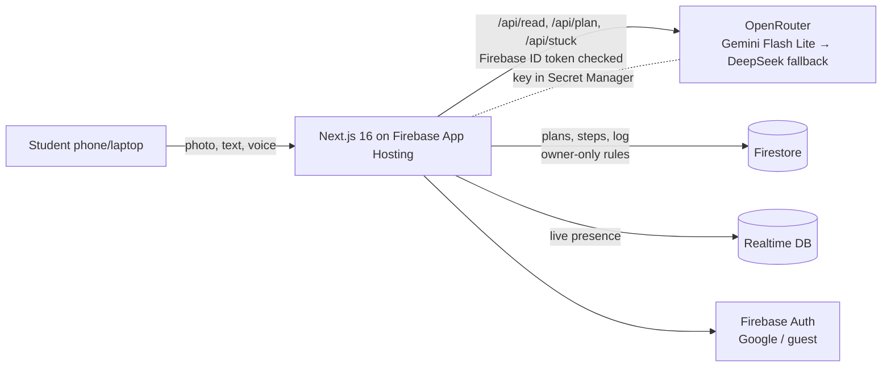

# Hakbang: one overwhelming task → one doable next step

**Live:** https://hakbang--prompt2-product.us-central1.hosted.app

## Problem
For college students with ADHD, the hardest part of a big project is often *starting*. Executive function
struggles with breaking work down, choosing what to do first, and sensing time. A 10-page brief turns into a
freeze, then cramming the night before.

## Persona
**Bea, 20, 3rd-year BS Psych in Laguna, diagnosed with ADHD.** She gets a research-proposal brief that's due in 9 days and can't tell where to begin.

## Solution
Bea photographs the brief. Hakbang's AI reads it, breaks it into small steps with time estimates, and reverse-plans
them into realistic daily blocks before the deadline. Then it shows **one** step at a time, starting with something
absurdly small ("Open a new doc and type the title, 2 min").

## Features
- **Photo / text / voice in**: snap the brief, paste it, or say "I'm stuck on my thesis" (Web Speech, fil-PH / en-PH)
- **Just 2 minutes**: step 1 is always tiny; the 2-min timer ends with "Keep going or stop?"
- **Smarter "I'm stuck"**: 5 kinds of stuck get different help:
  - too big → the unstuck ladder 15 → 5 → 2 min → "just open the file"
  - don't get it → plain explanation plus an example or template
  - scared → ugly-first-draft mode
  - boring → gamified
  - distracted → a reset first
- **Reverse deadline planning**: a 24-hour safety buffer and a no-guilt "on track" status, with re-plan from today
- **Philippine reality calendar**: lighter days on holidays (Undas, etc.); one tap for ⚡ brownout, 🌀 typhoon / walang pasok, 🚌 commute or 🤒 sick auto-reschedules everything
- **Energy-aware slots**: hard steps go in your peak focus time (morning / afternoon / night), easy ones anytime
- **Body-doubling room**: a live "👥 N studying with you now" (Firebase Realtime DB) and Kasama, an animated study buddy
- **Focus tools**: sprints of 2 / 10 / 15 / 25 min, breaks, a shrinking visual timer, a distraction parking lot, a hyperfocus guard and a tab-return nudge
- **Pick-for-me**: with several plans, Hakbang chooses one, because choosing is itself a freeze trigger
- **English / Taglish**, Google or guest sign-in, and private, owner-only data

## How AI is used
| Step | Model (OpenRouter) | Output |
|---|---|---|
| Read the brief (photo or text) | Gemini 2.5 Flash Lite | Deliverables, requirements, deadline |
| Plan | Gemini 2.5 Flash Lite | 10–18 steps with minutes and energy |
| I'm stuck | Gemini 2.5 Flash Lite | 2–4 smaller steps, encouragement, optional example |
| Fallback | DeepSeek V4 Flash | Automatic retry path if the first model fails |

All AI output is strict JSON validated with zod, with a retry and a model fallback. Scheduling, the PH calendar and
rescheduling are deterministic code, so the AI drafts and the student stays in control.

## Architecture


## Feasibility & impact (estimates)
- **Cost per plan** ≈ 1,400 input + 2,000 output tokens on Gemini Flash Lite ≈ **US$0.001 (≈ ₱0.06)**. A Stuck tap ≈ US$0.0001. These are computed from logged tokens × OpenRouter list prices.
- **Who benefits / who pays:** students use it free. Universities' guidance and PWD-support offices, or a CARD-style education partner, sponsor seats.
- **Pilot:** one guidance office in Laguna, 1 semester. Measure on-time submissions and self-reported "time to start."
- **Scale:** serverless (Cloud Run via App Hosting) + Firebase, max 2 instances in the prototype.
- **Privacy (RA 10173):** auth required, per-user Firestore rules, the AI key stays server-side, photos are not stored.

## Real vs simulated
- **Real:** AI reading, planning and stuck help; scheduling; PH holidays; disruption rescheduling; live study room; auth; the database.
- **Simulated / roadmap:** automatic PAGASA and class-suspension detection; calendar sync and reminders; Do Not Disturb linking; learned time padding (focus time is already recorded); weekly reflection and pattern insights.

## Run locally
```sh
cd web
npm install
# web/.env.local is generated from the root .env (see CLAUDE.md Setup)
npm run dev   # http://localhost:3000  (add ?fast=1 to speed up timers)
```
Deploy: `npx firebase-tools deploy --only apphosting,firestore:rules,database --project prompt2-product`

## Team
*(names + roles)*
